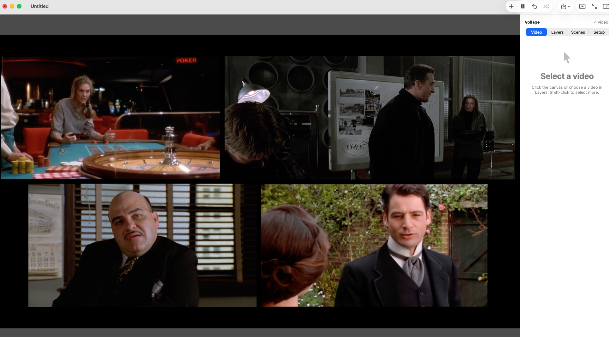

# Vollage

**Turn your video collection into a living collage.**

Vollage is a native Mac app for creating video collages that play, loop, and change in real time. Bring clips together on a single canvas, arrange them side by side, or overlap them with blend modes. Shuffle through a folder of footage to discover unexpected combinations, keep the moments you like, and let the rest change around them.



Build a composition by hand, set up an ever-changing video wall, or experiment with footage as a visual instrument. Vollage gives you direct control over each clip and a quick way to capture what happens.

- **Compose freely.** Drag, resize, layer, and mirror videos, or arrange them in a grid that respects their proportions.
- **Find new combinations.** Shuffle on demand or at a chosen interval. Keep favorite clips in the mix and lock elements in place.
- **Shape the playback.** Adjust speed, scrub to a moment, pause individual clips, and mix their audio. Combine layers with Screen, Multiply, Difference, and Overlay blending.
- **Save a set of scenes.** Capture up to nine compositions and recall them with a keystroke.
- **Let the visuals fill the screen.** Hide the editing controls with Clean View or go fullscreen.
- **Keep what you create.** Export a still image, record the canvas with mixed audio to MP4, and save compact projects that reference your original videos.

Built with SwiftUI, AppKit, and AVFoundation for **macOS 26 and later**.

## Build

```sh
./build.sh --open
```

The ad hoc signed app is created at `build/Vollage.app`. Use `--debug` for development. Every build also installs to `/Applications/Vollage.app`; `--open` opens that installed copy. This native app is the maintained version of Vollage. The former Electron app has been retired.

`tools/swift.sh` isolates outdated private PackageDescription interfaces in this Mac's Command Line Tools. It copies the matching public interfaces and library to `/tmp/vollage-native-build/toolchain`, selects the existing macOS 26.5 SDK when available, and uses SwiftPM's native build engine. No SDK is copied and no global developer settings change. SwiftPM emits a deprecation notice for this engine. `VOLLAGE_BUILD_ROOT` and `VOLLAGE_SDK` override the defaults.

## Settings

Open **Vollage > Settings…** (Command-comma) or click the toolbar gear. Choose **System**, **Light**, or **Dark** appearance. System follows your Mac; your choice applies immediately to every Vollage window and is remembered across launches.

## Editing

Add videos or drag files from Finder onto the canvas. MP4, M4V, MOV, MKV, WMV, FLV, AVI and WebM are accepted. AVFoundation is tried first; unsupported media is converted locally using FFmpeg at `/opt/homebrew/bin/ffmpeg` or `/usr/local/bin/ffmpeg`. Originals remain unchanged. Corrupt or protected files may still fail.

Click a video to select it; Shift-click extends or toggles selection. Drag selected videos together. Drag any selected corner to scale the group's sizes and spacing around the opposite corner. Position-locked members stay fixed. Selection does not change stacking order. Layers gives access to covered videos.

The Video inspector provides individual play/pause, scrubbing, speed 0–1600%, volume, mute, mirror, five blend modes, keep/position locks, double size, layer order, duplicate, delete, source rating, external-player opening and Reveal in Finder. Playback/effect controls apply to all selected videos. The timeline and rating apply to a single video.

Undo/redo covers composition edits, scenes, folder settings and transforms; a drag or slider gesture is one history step. The last 50 snapshots are retained. Source ratings live outside the document and are not part of composition undo.

## FrameShift effects test build

Run `./build.sh --effects-test` to install **Vollage Effects Test** in your home Applications folder. It uses separate settings and recovery data. Select one video and open **Video → Appearance → Effects**. Add **Displacement Map**, **Slit-Scan**, or **Video Feedback**. Open an effect to adjust its parameters and Mix. Use its action menu to bypass, reorder, or remove it. The stack runs from top to bottom.

Effects appear in the live canvas, screenshots, scene previews, and MP4 recordings. Shuffle keeps the settings in each slot. Seeking, replacing footage, or recalling a scene starts a fresh effect history. Projects with effects require a build that supports them. Use Save Project As when you want a separate test copy of an existing project.

Run `tools/effects-test.sh` after building to check the effects with generated clips and a 20-second Full HD recording. Use `VOLLAGE_TEST_APP` to select an installed copy for the checks.

## Folders, layout and ratings

Setup contains the recursive source folder, requested count (1–100), automatic shuffle and interval (2–3600 seconds), canvas size, and grid arrangement. Changing the count shuffles immediately. Fewer available files produces fewer videos; sources are not duplicated to fill slots.

Keep Video preserves a source while allowing grid movement. Lock Position preserves its source and geometry. Neither is removed to satisfy a lower count. Shuffles prefer sources not currently displayed and preserve playback/effect settings in replaced slots. A grid maximizes video area among candidate row layouts using actual aspect ratios, within free space around position locks. An active grid reflows with workspace size. Dragging or manual resizing switches to manual placement.

Automatic shuffle waits while globally paused, busy, hidden, or showing a modal file dialog. Existing videos continue during preparation. Automatic mode and the source folder are restored from projects when the folder remains accessible. New videos are muted by default.

Unrated or 1–10 ratings are written atomically to `vollage-ratings.json` in the source file's directory and refreshed across native windows. They do not affect shuffle probability. Embedded-only media uses its extracted copy's directory. Renaming/moving a source requires updating its rating sidecar.

## Projects and scenes

Command-N creates an independent document window. Command-O opens projects in new windows. Command-S saves to the current project; Command-Shift-S saves under another name.

Normal `.vollage` saves contain settings, scene previews, and references to the original videos; they do not copy video data into the project. References are shared across the current composition and all nine scenes. Keep the original videos available. Relative paths let a project and its media folder move together; absolute paths also allow a project to move separately on the same Mac. Missing media produces an error without replacing the current composition. Converted playback files are regenerated from originals when needed.

Existing embedded projects (browser versions 1/4 and desktop version 5) still open. Saving them writes the smaller linked format (version 6), referencing originals where available or extracted media in the app cache otherwise. Keep the old embedded project as a backup if its originals are gone. Existing files shrink when saved again; other saved copies are unchanged. Linked saves require the native app and cannot open in the retired Electron app. Earlier `.vollage-native` version-1 files can also be imported, provided their original media still exists.

Scenes capture videos, geometry, layer order, playback positions/settings, locks, blending and global pause. Use the Scenes tab to capture/update, name and recall a slot. Previews are saved in the project. Scene recall deliberately replaces the complete composition, including kept and locked videos.

Windows display project names and edited state. Closing edited work offers Save, Discard or Cancel. Saving from that prompt closes the document after success. Finish recording before closing. The existing bundle identifier (`com.vollage.native`) and data directory are retained so the rename preserves preferences and cached media. Recovery snapshots are refreshed after edits and periodically in `~/Library/Application Support/VollageNative/recovery`; interrupted documents reopen. Recovery references local sources/cache files and is not a backup against deleting them. Embedded originals, conversions and decoded recording audio are cached under the same application-support directory.

## Output

Resize Output Frame (in Setup or Save and Output) shows draggable edges and corners. Resizing changes the output boundary while preserving video pixel sizes and positions, and supports undo/redo. Escape or Done Resizing finishes. New compositions use a fixed Full HD frame independent of the app window. Output dimensions are locked during recording. Window Size fills the available canvas; fixed HD, Full HD, 4K, square and portrait presets preserve an output aspect ratio. Preview, screenshots and recordings share the same Core Image compositor, including mirrored video and Normal, Screen, Multiply, Difference and Overlay blending.

Save Screenshot writes a PNG at canvas resolution. Record Output streams H.264 video and mixed stereo AAC audio to an MP4. Source audio respects mute, volume, pause and speed. FFmpeg prepares decoded audio in a disk cache; no microphone or screen-recording permission is needed for composition output. A recording badge and Stop control remain available in clean view. Real-time performance depends on media, video count, resolution and hardware; overloaded rendering can drop frames.

Clean View hides editing controls and disables editing. Fullscreen is independent. Playback, shuffle, scene recall, screenshot and recording remain available.

Motion recording and playback are not supported. Imported motion is ignored, and a notice explains that saving omits it.

## Keyboard

| Shortcut | Action |
| --- | --- |
| Command-N / O / S / Shift-S | New / Open / Save / Save As |
| Command-Z / Shift-Z | Undo / Redo |
| Command-A / Command-D | Select all videos / Duplicate |
| Space | Play/pause all while preserving individual pause |
| P / Escape | Clean view / Return to editing |
| Return | Fullscreen |
| G / Shift-G | Arrange grid / Shuffle |
| K / Shift-K | Keep video / Lock position |
| 1–9 / Shift-1–9 | Recall / Capture scene |
| H / V | Screenshot / Start or stop output recording |
| + / − | Adjust selected speed by 25 percentage points |
| [ / ] | Adjust selected volume by 10% |
| M / N | Mirror / Mute |
| A / B | Forward / Backward one layer |
| C / Delete / Z | Duplicate / Delete / Double size |
| U / Y | Undo / Redo |
| O / L / S | Add videos / Open project / Save project |
| R / Q | Remove all videos / Close document |

Unmodified editing shortcuts apply while the canvas has focus; click the canvas to return focus from the inspector. Inspector controls and text fields receive their normal keyboard input. Arrow keys move selected, unlocked videos by one pixel; Shift-arrow moves ten pixels. Escape leaves clean view from anywhere in the window. Help is available from the Help menu.

## Tests

```sh
tools/selftest.sh
tools/tooltip-test.sh
tools/grid-lint.sh
```

The self-test uses generated color, portrait, rotated and legacy-codec video, plus two audio tones, in `/tmp`. It verifies actual playback, pause, looping, undo/redo, selection edits, locked/free-region grids, pinned shuffle/count changes, automatic shuffle, scenes, ratings, conversion caching, small linked saves, linked media relocation and missing-file handling, portable media without originals, recovery storage, per-pixel blending, and recorded video/audio tracks. It opens a separate embedded-format test export with a frozen legacy storage module in `Tests/Compatibility`, saves it there, and reopens that output and legacy browser-format fixtures natively. It also checks that both source tones reach the recording and captures all inspector tabs in light/dark appearances.

`VOLLAGE_DATA_ROOT` isolates test state. `VOLLAGE_TEST_MEDIA` selects test fixtures; `VOLLAGE_UI_ONLY=1` seeds an interactive test window without running the assertions. No personal videos or projects are used during verification.

`tools/tooltip-test.sh` checks native toolbar tooltip registration for all nine actions and repeats after playback and sidebar changes. SwiftUI `.help` is supplemented on the AppKit toolbar items and host views because this macOS toolbar integration can drop button help.
